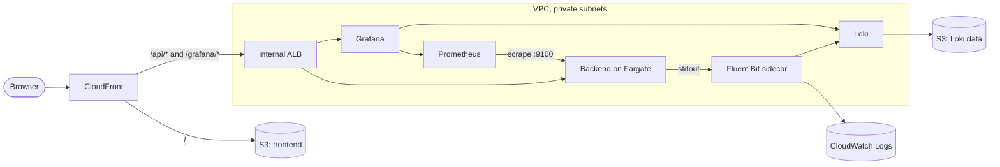
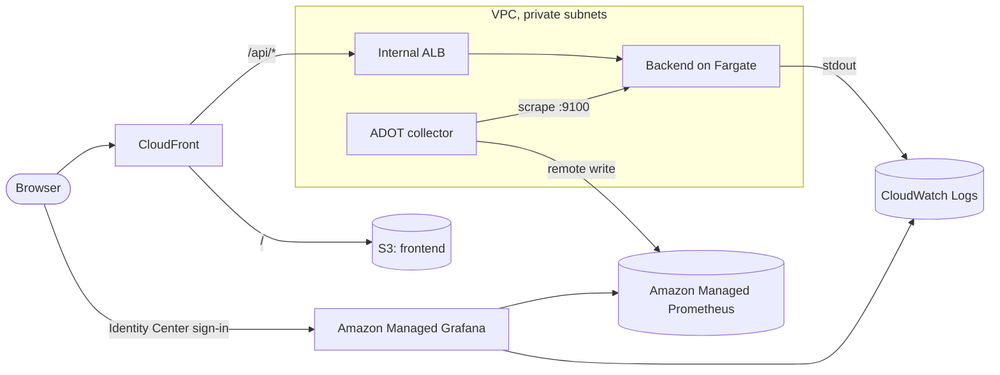

# AWS-ObservabilityLab

A tiny web app on AWS Fargate that turns user clicks into metrics and logs, observed with Prometheus
and Grafana. The monitoring runs either self-hosted or AWS-managed, switchable with one Terraform
variable. Everything, from the network to the dashboards, is code; the same dashboards and alert rules
are used locally and in both AWS modes.

Click a button in the app and watch the request show up in the dashboards: request rate, errors,
latency, the log lines it wrote, and the alerts it trips.

## Architecture on AWS

Both modes share the same entry: CloudFront serves the frontend from S3 and forwards `/api/*` to an
internal ALB in front of the backend tasks. They differ in who collects, stores and shows the
metrics and logs.

**`self_hosted`**: we run Prometheus, Loki and Grafana on Fargate.



**`managed`**: AWS stores the metrics and logs and runs Grafana; we only run a small collector.



| | `self_hosted` | `managed` |
| --- | --- | --- |
| Metrics | Prometheus on Fargate scrapes the backend and stores the series on its disk | An ADOT collector on Fargate scrapes the backend and remote-writes to Amazon Managed Prometheus |
| Alert rules | Evaluated by Prometheus | Evaluated by Amazon Managed Prometheus |
| Logs | Fluent Bit (FireLens) ships them to Loki, which stores them in S3; a copy goes to CloudWatch | CloudWatch Logs only |
| Dashboards | Grafana on Fargate at `/grafana` on the app's URL, anonymous and read-only | Amazon Managed Grafana at its own URL, signing in through IAM Identity Center |
| Region | Any; default `eu-central-2` (Zurich) | `eu-central-1` (Frankfurt): Managed Grafana isn't in Zurich |

In both modes, CloudFront is the only public entry point. The ALB is internal and only reachable from
CloudFront; the tasks run in private subnets, and AWS traffic (image pulls, logs, metrics) goes
through VPC endpoints. The services find each other through Cloud Map DNS
(`backend.observability.internal`).

Deploys and teardowns are GitHub Actions workflows started by hand: **Deploy** builds the commit's
images, applies Terraform and uploads the frontend; **Destroy** removes the whole stack. The lab is
meant to be destroyed when not in use, since NAT gateways, Fargate and the endpoints are billed by the
hour.

## How it fits together locally

```
 browser ─► frontend (Vue, nginx) ──/api──► backend (FastAPI)
                                              │                 │
                                       metrics :9100     JSON logs (stdout)
                                              │                 │
                                              ▼                 ▼
                                     Prometheus (pulls)   Alloy ──► Loki
                                              │                 │
                                              └──► Grafana ◄────┘
                                              dashboards + alerts
```

Metrics answer "how many, how fast, how many errors". Logs answer "what exactly happened to this
request". The request ID ties the two together: the frontend shows it, the backend logs it.

## What each component is, and why it's here

### The app

| Component | What it is | Why |
| --- | --- | --- |
| **FastAPI** | Python web framework, built on **Starlette** | Small, typed, async; serves the demo endpoints |
| **uvicorn** | The server that runs the FastAPI app | Standard production server for async Python apps |
| **prometheus_client** | Python library for defining metrics and serving them as text | The official way to expose Prometheus metrics |
| **uv** | Python package and project manager | Fast, with a lockfile for reproducible installs |
| **Vue 3 + TypeScript** | Frontend framework | Reactive UI for the buttons, stats and log, with type checking |
| **Vite** | Frontend build tool and dev server | Fast dev server; builds plain static files for S3 |
| **nginx** | Web server and reverse proxy | Locally, plays CloudFront's role: serves the static files and forwards `/api` to the backend |

### Observability

| Component | What it is | Why |
| --- | --- | --- |
| **Prometheus** | Time-series database that **pulls** metrics: every 10 s it fetches `backend:9100/metrics` | Stores metric history and evaluates the alert rules |
| **Loki** | Log database from Grafana Labs | Stores the backend's JSON logs; searchable by labels and text, like Prometheus for logs |
| **Alloy** | Grafana Labs' collector agent, the successor to Promtail | Locally: reads the backend container's stdout through the Docker socket, labels each line (`service`, `level`) and pushes it to Loki. The app only prints logs and doesn't know Loki exists |
| **Fluent Bit (FireLens)** | Log router, run by ECS next to the backend container | `self_hosted` on AWS: Fargate has no Docker socket, so ECS hands the container's stdout to Fluent Bit, which ships it to Loki and CloudWatch |
| **Grafana** | Visualisation tool; stores no data itself | Queries Prometheus and Loki (or AMP and CloudWatch) and draws the dashboards; the same dashboards work in every environment |

### AWS

| Component | Why |
| --- | --- |
| **CloudFront** | Single public entry point: `/` → S3, `/api/*` (and `/grafana/*` when self-hosted) → ALB |
| **S3** | Hosts the built frontend files; stores Loki's data when self-hosted |
| **ALB** | Internal load balancer in front of the backend; only reachable from CloudFront |
| **ECS Fargate** | Runs the backend and the monitoring containers without managing servers |
| **Cloud Map** | Private DNS for the services, so Prometheus or ADOT finds every backend task |
| **ECR** | Holds the images, tagged with the git commit; replicated to Frankfurt for `managed` mode |
| **CloudWatch Logs** | The backend's logs in `managed` mode, and every container's own logs |
| **Amazon Managed Service for Prometheus (AMP)** | `managed` mode: AWS stores the metrics and evaluates the alert rules |
| **ADOT** (AWS Distro for OpenTelemetry) | `managed` mode: AMP doesn't scrape ECS by itself, so this collector scrapes the backend and sends the metrics to AMP |
| **Amazon Managed Grafana (AMG)** | `managed` mode: AWS runs Grafana; people sign in through IAM Identity Center |
| **Terraform** | All infrastructure as code, including Grafana's data sources and dashboards in `managed` mode |
| **GitHub Actions** | CI on every push; manual Deploy and Destroy workflows, with short-lived AWS credentials through OIDC |

## Repository layout

| Path | Contents | Docs |
| --- | --- | --- |
| `backend/` | FastAPI service | [backend/README.md](backend/README.md) |
| `frontend/` | Vue single-page app | [frontend/README.md](frontend/README.md) |
| `observability/` | Grafana dashboards and Prometheus alert rules, shared by every environment | [observability/README.md](observability/README.md) |
| `local/` | Config for the local Docker Compose stack only (nginx, Prometheus, Loki, Alloy, Grafana provisioning) | |
| `infrastructure/` | Terraform for AWS: the bootstrap stack, the main stack, and the monitoring images | [infrastructure/README.md](infrastructure/README.md) |
| `.github/workflows/` | CI, Build images, Deploy, Destroy | [infrastructure/README.md](infrastructure/README.md#deploy-and-destroy) |

## Run locally

Requires Docker. No AWS account needed.

```bash
docker compose up --build
```

| Service | URL | What to look at |
| --- | --- | --- |
| App | http://localhost:8080 | Click the buttons, or fire a burst of 20 or 100 requests |
| Grafana | http://localhost:3000 (no login) | Dashboards → Observability Lab → **Overview** (metrics, alerts) and **Logs** |
| Prometheus | http://localhost:9090 | Raw metrics queries; **Alerts** tab shows every rule's state |

**Logs** are in Grafana: open the **Observability Lab / Logs** dashboard, or go to **Explore**,
pick **Loki** and run `{service="backend"}`. To follow a single request, paste its request ID from
the app into the dashboard's Search box.

If a port is taken, override it, e.g. `APP_PORT=8081 docker compose up`.

`docker compose down` stops everything; add `-v` to also delete the stored metrics and dashboards
state.

## Run on AWS

Needs an AWS account with IAM Identity Center, and this repository (or a fork) on GitHub. The full
guide, from an empty account to the running lab and back, is in
[infrastructure/README.md](infrastructure/README.md#deploy-everything). In short:

1. Once per account: log in with `aws configure sso`, run `infrastructure/bootstrap/bootstrap.sh`
   (state bucket, CI roles, ECR, budget), and copy its outputs into the repository variables.
2. Actions → **Deploy** → pick the region and `self_hosted` or `managed`. About 20 minutes.
3. Open the URL in the run's summary: the app, and Grafana's link in its header.
4. Actions → **Destroy** when you're done.
